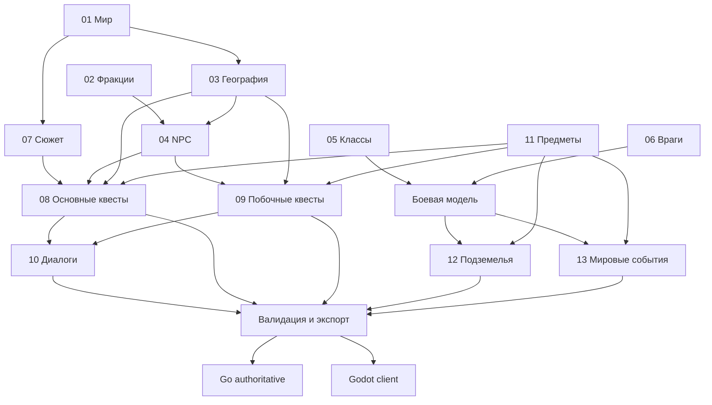

# LUNEX MMORPG - 14_CONTENT_INTEGRATION.md
**Версия:** 1.0 | **Статус:** проект для утверждения | **Контур:** 13 утверждённых спецификаций, 6 регионов, Android landscape, Godot 4.7.2 + Go + PostgreSQL + React/TypeScript.

> Это интеграционный контракт и план работ для Cursor, а не отчёт о фактической готовности кода. Ни одна система не считается реализованной без проверки репозитория и прохождения тестов. Этот документ не даёт разрешения менять VPS, GitHub, деплой, секреты или рабочие сервисы без отдельного задания. `13_WORLD_EVENTS.md` пока не следует считать опубликованным в GitHub без проверки.

## 1. Назначение, принцип источника истины

- Канон мира и терминология: `01_WORLD.md`; фракции и репутация: `02_FACTIONS.md`; география: `03_LOCATIONS.md`; NPC: `04_CHARACTERS.md`; классы: `05_CLASSES.md`; враги: `06_ENEMIES.md`; сюжетные причины и финалы: `07_STORY.md`.
- Основные квесты: `08_QUESTS_MAIN.md`; побочные: `09_QUESTS_SIDE.md`; реплики и варианты: `10_DIALOGUES.md`; предметы и экономика: `11_ITEMS_LOOT.md`; инстансы: `12_DUNGEONS.md`; публичные события: `13_WORLD_EVENTS.md`.
- При расхождении: нельзя молча выбирать удобную версию. Сначала записать `docs/content/CONFLICTS.md` (источники, конкретные ID, влияние, варианты исправления), затем получить решение автора. Технические примеры не могут отменять сюжетный канон.
- Идентификатор не переименовывать после публикации; вместо удаления использовать `deprecated`, `redirect_id` для UI/локализации, миграцию ссылок и архивную совместимость сохранений.
- Все изменения данных версионировать и валидировать в CI до сборки APK. Клиент не является источником истины для квестов, добычи, боёв и валют.

## 2. Реестр утверждённых документов

| № | Файл | Авторитетная область | Проверка интеграции |
|---:|---|---|---|
| 01 | `01_WORLD.md` | мир, история, законы магии | наличие, парсинг, разрешение ссылок |
| 02 | `02_FACTIONS.md` | фракции, отношения, репутация | наличие, парсинг, разрешение ссылок |
| 03 | `03_LOCATIONS.md` | регионы, LOC/POI, переходы | наличие, парсинг, разрешение ссылок |
| 04 | `04_CHARACTERS.md` | NPC, роль, место, голос | наличие, парсинг, разрешение ссылок |
| 05 | `05_CLASSES.md` | классы, роли, умения | наличие, парсинг, разрешение ссылок |
| 06 | `06_ENEMIES.md` | 96 врагов, AI, параметры | наличие, парсинг, разрешение ссылок |
| 07 | `07_STORY.md` | главы, поворотные точки, финалы | наличие, парсинг, разрешение ссылок |
| 08 | `08_QUESTS_MAIN.md` | 120 MQ, цели, флаги | наличие, парсинг, разрешение ссылок |
| 09 | `09_QUESTS_SIDE.md` | 120 SQ, цепочки, флаги | наличие, парсинг, разрешение ссылок |
| 10 | `10_DIALOGUES.md` | диалоги, условия, локализация | наличие, парсинг, разрешение ссылок |
| 11 | `11_ITEMS_LOOT.md` | экипировка, предметы, лут | наличие, парсинг, разрешение ссылок |
| 12 | `12_DUNGEONS.md` | 12 инстансов, боссы, комнаты | наличие, парсинг, разрешение ссылок |
| 13 | `13_WORLD_EVENTS.md` | 18 событий, расписания, вклад | наличие, парсинг, разрешение ссылок |

## 3. Проверяемый базовый объём и границы данных

Числа ниже описывают **обнаруженные ID в текстах**, а не готовность реализации. Это лексический аудит (включая упоминания ID), не доказательство уникальности объявлений. Нормализованный контентный экспорт должен отдельно проверять объявления и ссылки.

| Категория | Ожидается по дизайну | Уникальных ID, встречающихся в профильном MD | Что проверить в экспорте |
|---|---:|---:|---|
| Фракции | 8 | 8 | 8 объявлений, без дублей |
| LOC | 48 | 48 | по 8 LOC в регионе |
| NPC | 32 | 32 | канонические NPC и роли |
| Классы | 5 | 5 | 5 классов, навыки отдельно |
| Враги | 96 | 96 | 96 врагов, классы угроз |
| Основные квесты | 120 | 120 | 20 MQ на регион |
| Побочные квесты | 120 | 120 | 20 SQ на регион |
| Подземелья | 12 | 12 | 2 DNG на регион |
| Публичные события | 18 | 18 | 3 EVT на регион |

## 4. Единый реестр ID и пространства имён

| Пространство | Формат | Источник | Семантика и правило |
|---|---|---|---|
| Мир | `REG-RR` | 03 | RR=01..06; не меняется при переименовании региона |
| Фракция | `FAC-01..08` | 02 | репутация отдельной записью игрока |
| NPC | `NPC-NNN` | 04 | единая сущность, локация через NPC placement |
| Локация | `LOC-RR-NNN` | 03 | существование, тип зоны, маршрут |
| Точка интереса | `POI-RR-NNN` | 03 | координаты и интерактивная цель |
| Подземелье | `DNG-RR-001/002` | 03/12 | отдельный инстанс; `POI-RR-006/007` входы |
| Враг | `ENM-RR-NNN` | 06 | `001..008` normal, `101..103` elite, `201..202` miniboss, `301..302` dungeon boss, `401` world boss |
| Класс | `CLS-01..05` | 05 | роль и дерево способностей |
| Главный квест | `MQ-RR-SS` | 08 | 20 на регион, SS=01..20 |
| Побочный квест | `SQ-RR-SSS` | 09 | 20 на регион; не смешивать с MQ |
| Цель главного квеста | `OBJ-RR-SS-N` | 08 | цель с N=1..3 |
| Цель побочного квеста | `OBJ-SQ-RR-SSS-N` | 09 | отдельный namespace |
| Флаг | `QF-MQ-*` / `QF-SQ-*` | 08/09 | только сервер, явная схема миграции |
| Диалог | `DLG-*` / узлы | 10 | конкретный ключ берётся из файла, не придумывать замены |
| Предмет | `ITM-RR-NNN`, `MAT-RR-NNN`, `EQ-*`, `SET-*` | 11 | стабильный каталог; `EQ-CC-RR-SS-RR` содержит повтор RR для разных сущностей: использовать позиционное именование, не общий regex без схемы |
| Добыча | `LOOT-*` | 11 | loot pool и права выдачи |
| Событие | `EVT-RR-001..003` | 13 | 001 сопровождение, 002 аномалия, 003 мировой босс |
| Спавн/ресурс | `SPAWN-*`, `RES-*` | 03/06 | контекст региона и зоны |
| Поселение | `STL-RR-NN` | 03 | региональный центр, поселение, застава; префикс отличен от `SET-CC-RR` (набор экипировки, 11) |
| Переход | `RTE-*`, `TP-*` | 03 | маршрут и условия доступа |

**Коллизии:** одна строка ID может упоминаться в нескольких документах, но объявляться должна в одном владельце. Парсер сохраняет `source_file`, `source_line`, `declaration_kind`, `references[]`. Взаимные ссылки не считаются дублями объявлений. Проверять Unicode NFC, дефисы ASCII, регистр и пробелы. `RR` в разных форматах не означает одно и то же; хранить структурированные поля и генерировать ID по типу.

## 5. Граф зависимостей и запреты



**Жёсткие запреты:** обязательный MQ не требует убийства `ENM-RR-401`; репутация FAC не блокирует основной сюжет; платный предмет не обязателен для прохождения; концовка `END-01..03` персональна и не изменяет глобальную географию; квестовые ключи не продаются, не уничтожаются, не выпадают случайно; никакой случайный таймер не удаляет незавершённый прогресс MQ; подземелья/мировые события не допускают повторного начисления награды за один `reward_claim_id`.

## 7. Матрица интеграции REG-01: Долина Рассвета

| Подсистема | Конкретный контракт |
|---|---|
| География | `REG-01`, `LOC-01-001..008`, `POI-01-001..012`; стартовая безопасная зона `LOC-01-001`, сюжетный узел `LOC-01-005` |
| Кампания | `MQ-01-01..20`; ровно 20 заданий; три серверно подтверждённые цели на квест |
| Побочные | 20 `SQ-01-*` из 09, открываются по конкретным условиям файла, не по произвольной репутации |
| NPC | только записи `NPC-*`, назначенные этому региону в 04; не создавать дублей персонажей |
| Враги | `ENM-01-001..008`, `101..103`, `201..202`, `301..302`, `401` |
| Инстансы | `DNG-01-001` через `POI-01-006`; `DNG-01-002` через `POI-01-007` |
| Публичные активности | `EVT-01-001` караван; `EVT-01-002` аномалия; `EVT-01-003` мировой босс |
| Мировой босс | `ENM-01-401` Колокол Несуществующего Полудня; необязательный для сюжетного финала |
| Экипировка | каталог `EQ-CC-01-*`, материалы `MAT-01-*`, региональные наборы `SET-CC-01` из 11 |
| Тест-гейт | пройти основной путь, 1 SQ, 1 событие, 1 инстанс, перезаход и идемпотентную награду |

**Сценарий связности:** войти в `LOC-01-001` -> поговорить с каноническим NPC -> принять `MQ-01-01` -> сервер выдаёт только разрешённые цели -> прогресс при событии `objective_event` -> награда через ledger -> доступность следующего MQ по prerequisite -> доступность SQ по собственным условиям -> вход в `DNG-01-001` как отдельный инстанс -> событие `EVT-01-001` как публичная активность. Ни один из этих путей не должен использовать несуществующий ID.

**Проверки региона:** соответствие всех `LOC/POI` географическому документу; отсутствие неверного NPC в квесте; enemy loot с валидным `LOOT`; локализованные диалоги для открытия, цели, сдачи и отказа; безопасный возврат после дисконнекта в инстансе; контроль видимости других игроков и NPC; мобильный интерфейс в landscape.

## 8. Матрица интеграции REG-02: Серебряные леса

| Подсистема | Конкретный контракт |
|---|---|
| География | `REG-02`, `LOC-02-001..008`, `POI-02-001..012`; стартовая безопасная зона `LOC-02-001`, сюжетный узел `LOC-02-005` |
| Кампания | `MQ-02-01..20`; ровно 20 заданий; три серверно подтверждённые цели на квест |
| Побочные | 20 `SQ-02-*` из 09, открываются по конкретным условиям файла, не по произвольной репутации |
| NPC | только записи `NPC-*`, назначенные этому региону в 04; не создавать дублей персонажей |
| Враги | `ENM-02-001..008`, `101..103`, `201..202`, `301..302`, `401` |
| Инстансы | `DNG-02-001` через `POI-02-006`; `DNG-02-002` через `POI-02-007` |
| Публичные активности | `EVT-02-001` караван; `EVT-02-002` аномалия; `EVT-02-003` мировой босс |
| Мировой босс | `ENM-02-401` Древо Непрожитой Весны; необязательный для сюжетного финала |
| Экипировка | каталог `EQ-CC-02-*`, материалы `MAT-02-*`, региональные наборы `SET-CC-02` из 11 |
| Тест-гейт | пройти основной путь, 1 SQ, 1 событие, 1 инстанс, перезаход и идемпотентную награду |

**Сценарий связности:** войти в `LOC-02-001` -> поговорить с каноническим NPC -> принять `MQ-02-01` -> сервер выдаёт только разрешённые цели -> прогресс при событии `objective_event` -> награда через ledger -> доступность следующего MQ по prerequisite -> доступность SQ по собственным условиям -> вход в `DNG-02-001` как отдельный инстанс -> событие `EVT-02-001` как публичная активность. Ни один из этих путей не должен использовать несуществующий ID.

**Проверки региона:** соответствие всех `LOC/POI` географическому документу; отсутствие неверного NPC в квесте; enemy loot с валидным `LOOT`; локализованные диалоги для открытия, цели, сдачи и отказа; безопасный возврат после дисконнекта в инстансе; контроль видимости других игроков и NPC; мобильный интерфейс в landscape.

## 9. Матрица интеграции REG-03: Пепельные земли

| Подсистема | Конкретный контракт |
|---|---|
| География | `REG-03`, `LOC-03-001..008`, `POI-03-001..012`; стартовая безопасная зона `LOC-03-001`, сюжетный узел `LOC-03-005` |
| Кампания | `MQ-03-01..20`; ровно 20 заданий; три серверно подтверждённые цели на квест |
| Побочные | 20 `SQ-03-*` из 09, открываются по конкретным условиям файла, не по произвольной репутации |
| NPC | только записи `NPC-*`, назначенные этому региону в 04; не создавать дублей персонажей |
| Враги | `ENM-03-001..008`, `101..103`, `201..202`, `301..302`, `401` |
| Инстансы | `DNG-03-001` через `POI-03-006`; `DNG-03-002` через `POI-03-007` |
| Публичные активности | `EVT-03-001` караван; `EVT-03-002` аномалия; `EVT-03-003` мировой босс |
| Мировой босс | `ENM-03-401` Наковальня Последней Войны; необязательный для сюжетного финала |
| Экипировка | каталог `EQ-CC-03-*`, материалы `MAT-03-*`, региональные наборы `SET-CC-03` из 11 |
| Тест-гейт | пройти основной путь, 1 SQ, 1 событие, 1 инстанс, перезаход и идемпотентную награду |

**Сценарий связности:** войти в `LOC-03-001` -> поговорить с каноническим NPC -> принять `MQ-03-01` -> сервер выдаёт только разрешённые цели -> прогресс при событии `objective_event` -> награда через ledger -> доступность следующего MQ по prerequisite -> доступность SQ по собственным условиям -> вход в `DNG-03-001` как отдельный инстанс -> событие `EVT-03-001` как публичная активность. Ни один из этих путей не должен использовать несуществующий ID.

**Проверки региона:** соответствие всех `LOC/POI` географическому документу; отсутствие неверного NPC в квесте; enemy loot с валидным `LOOT`; локализованные диалоги для открытия, цели, сдачи и отказа; безопасный возврат после дисконнекта в инстансе; контроль видимости других игроков и NPC; мобильный интерфейс в landscape.

## 10. Матрица интеграции REG-04: Королевские пределы

| Подсистема | Конкретный контракт |
|---|---|
| География | `REG-04`, `LOC-04-001..008`, `POI-04-001..012`; стартовая безопасная зона `LOC-04-001`, сюжетный узел `LOC-04-005` |
| Кампания | `MQ-04-01..20`; ровно 20 заданий; три серверно подтверждённые цели на квест |
| Побочные | 20 `SQ-04-*` из 09, открываются по конкретным условиям файла, не по произвольной репутации |
| NPC | только записи `NPC-*`, назначенные этому региону в 04; не создавать дублей персонажей |
| Враги | `ENM-04-001..008`, `101..103`, `201..202`, `301..302`, `401` |
| Инстансы | `DNG-04-001` через `POI-04-006`; `DNG-04-002` через `POI-04-007` |
| Публичные активности | `EVT-04-001` караван; `EVT-04-002` аномалия; `EVT-04-003` мировой босс |
| Мировой босс | `ENM-04-401` Трон Безымянной Династии; необязательный для сюжетного финала |
| Экипировка | каталог `EQ-CC-04-*`, материалы `MAT-04-*`, региональные наборы `SET-CC-04` из 11 |
| Тест-гейт | пройти основной путь, 1 SQ, 1 событие, 1 инстанс, перезаход и идемпотентную награду |

**Сценарий связности:** войти в `LOC-04-001` -> поговорить с каноническим NPC -> принять `MQ-04-01` -> сервер выдаёт только разрешённые цели -> прогресс при событии `objective_event` -> награда через ledger -> доступность следующего MQ по prerequisite -> доступность SQ по собственным условиям -> вход в `DNG-04-001` как отдельный инстанс -> событие `EVT-04-001` как публичная активность. Ни один из этих путей не должен использовать несуществующий ID.

**Проверки региона:** соответствие всех `LOC/POI` географическому документу; отсутствие неверного NPC в квесте; enemy loot с валидным `LOOT`; локализованные диалоги для открытия, цели, сдачи и отказа; безопасный возврат после дисконнекта в инстансе; контроль видимости других игроков и NPC; мобильный интерфейс в landscape.

## 11. Матрица интеграции REG-05: Ледяной престол

| Подсистема | Конкретный контракт |
|---|---|
| География | `REG-05`, `LOC-05-001..008`, `POI-05-001..012`; стартовая безопасная зона `LOC-05-001`, сюжетный узел `LOC-05-005` |
| Кампания | `MQ-05-01..20`; ровно 20 заданий; три серверно подтверждённые цели на квест |
| Побочные | 20 `SQ-05-*` из 09, открываются по конкретным условиям файла, не по произвольной репутации |
| NPC | только записи `NPC-*`, назначенные этому региону в 04; не создавать дублей персонажей |
| Враги | `ENM-05-001..008`, `101..103`, `201..202`, `301..302`, `401` |
| Инстансы | `DNG-05-001` через `POI-05-006`; `DNG-05-002` через `POI-05-007` |
| Публичные активности | `EVT-05-001` караван; `EVT-05-002` аномалия; `EVT-05-003` мировой босс |
| Мировой босс | `ENM-05-401` Полуночный Маяк; необязательный для сюжетного финала |
| Экипировка | каталог `EQ-CC-05-*`, материалы `MAT-05-*`, региональные наборы `SET-CC-05` из 11 |
| Тест-гейт | пройти основной путь, 1 SQ, 1 событие, 1 инстанс, перезаход и идемпотентную награду |

**Сценарий связности:** войти в `LOC-05-001` -> поговорить с каноническим NPC -> принять `MQ-05-01` -> сервер выдаёт только разрешённые цели -> прогресс при событии `objective_event` -> награда через ledger -> доступность следующего MQ по prerequisite -> доступность SQ по собственным условиям -> вход в `DNG-05-001` как отдельный инстанс -> событие `EVT-05-001` как публичная активность. Ни один из этих путей не должен использовать несуществующий ID.

**Проверки региона:** соответствие всех `LOC/POI` географическому документу; отсутствие неверного NPC в квесте; enemy loot с валидным `LOOT`; локализованные диалоги для открытия, цели, сдачи и отказа; безопасный возврат после дисконнекта в инстансе; контроль видимости других игроков и NPC; мобильный интерфейс в landscape.

## 12. Матрица интеграции REG-06: Земли Последнего Света

| Подсистема | Конкретный контракт |
|---|---|
| География | `REG-06`, `LOC-06-001..008`, `POI-06-001..012`; стартовая безопасная зона `LOC-06-001`, сюжетный узел `LOC-06-005` |
| Кампания | `MQ-06-01..20`; ровно 20 заданий; три серверно подтверждённые цели на квест |
| Побочные | 20 `SQ-06-*` из 09, открываются по конкретным условиям файла, не по произвольной репутации |
| NPC | только записи `NPC-*`, назначенные этому региону в 04; не создавать дублей персонажей |
| Враги | `ENM-06-001..008`, `101..103`, `201..202`, `301..302`, `401` |
| Инстансы | `DNG-06-001` через `POI-06-006`; `DNG-06-002` через `POI-06-007` |
| Публичные активности | `EVT-06-001` караван; `EVT-06-002` аномалия; `EVT-06-003` мировой босс |
| Мировой босс | `ENM-06-401` Отголосок Последнего Рассвета; необязательный для сюжетного финала |
| Экипировка | каталог `EQ-CC-06-*`, материалы `MAT-06-*`, региональные наборы `SET-CC-06` из 11 |
| Тест-гейт | пройти основной путь, 1 SQ, 1 событие, 1 инстанс, перезаход и идемпотентную награду |

**Сценарий связности:** войти в `LOC-06-001` -> поговорить с каноническим NPC -> принять `MQ-06-01` -> сервер выдаёт только разрешённые цели -> прогресс при событии `objective_event` -> награда через ledger -> доступность следующего MQ по prerequisite -> доступность SQ по собственным условиям -> вход в `DNG-06-001` как отдельный инстанс -> событие `EVT-06-001` как публичная активность. Ни один из этих путей не должен использовать несуществующий ID.

**Проверки региона:** соответствие всех `LOC/POI` географическому документу; отсутствие неверного NPC в квесте; enemy loot с валидным `LOOT`; локализованные диалоги для открытия, цели, сдачи и отказа; безопасный возврат после дисконнекта в инстансе; контроль видимости других игроков и NPC; мобильный интерфейс в landscape.

## 13. Архитектура: клиент, сервер, данные, админка

### 13.1 Ответственность компонентов

**Godot 4.7.2:** 2.5D изометрическая сцена, управление, UI диалогов/квестов/инвентаря, визуальная репликация, клиентская интерполяция и VFX. Отображает только полученные серверные результаты. Не вычисляет истинные награды, урон, права на предмет или завершение цели.

**Go:** авторитетные сессии, движение/бой (в пределах утверждённой архитектуры), валидатор игровых событий, state machine квестов, диалоговые условия, инстансы, мировые события, выдача лута, транзакции, журнал аудита, ограничение частоты запросов.

**PostgreSQL:** durable игроки/персонажи, квестовые состояния, inventory ledger, инстансы, события, claim ledger, content version и миграции. Использовать транзакции и уникальные ограничения, а не in-memory флаги.

**React + TypeScript админка:** просмотр каталога, поиск ID и ссылок, конфиг таймеров, включение контента по региону, отчёты о нарушениях, аудит изменений, RBAC. Админка не записывает прямые SQL-патчи без серверной проверки.

### 13.2 Версионирование контента

`content_build_id` = SHA-256 нормализованного экспортного manifest, `schema_version` = версия формата, `minimum_client_version` = поддерживаемый клиент. Сервер хранит текущую и предыдущую совместимую версию. Клиент получает `content_build_id` при handshake, проверяет несовместимость, догружает только изменённые каталоги с CDN по хешу, не перекачивает весь мир. Миграции инстансов и квестов выполняются отдельно; активную попытку не переключать на несовместимую версию посреди боя.

### 13.3 Рекомендуемая структура репозитория (создавать только после аудита текущей)

```text
docs/content/01_WORLD.md ... 14_CONTENT_INTEGRATION.md
content/source/              # экспортируемые нормализованные JSON/YAML
content/schemas/             # JSON Schema и ограничения
content/manifests/           # hashes, versions, crossrefs
content/locales/ru-RU/       # строки и plural rules
content/locales/en-US/       # необязательная локаль, fallback
server/internal/content/     # загрузка, валидация, публикация
server/internal/quests/      # state machine и цели
server/internal/dialogue/    # условия и выборы
server/internal/loot/        # транзакции наград
server/internal/dungeons/    # инстансы
server/internal/events/      # мировые события
client/                      # фактический путь определить аудитом
admin/                       # фактический путь определить аудитом
tools/content/               # экспорт, lint, crossrefs, diff
```

**Не создавать вторую структуру рядом с уже работающей**. Пути выше только целевые; Cursor должен адаптировать их к существующему репозиторию.

## 14. Нормализованная модель данных

Каждый экспортный объект имеет: `id`, `kind`, `schema_version`, `source_file`, `source_line`, `region_id` (если применимо), `title_key`, `content_version`, `enabled`, `dependencies[]`. Для квеста дополнительно `prerequisites`, `objectives[]`, `reward_bundle_id`, `npc_start_id`, `npc_finish_id`, `dialogue_ids[]`, `flags`, `repeat_policy`. Для врага: `enemy_role`, `level_range`, `spawn_profile_id`, `abilities[]`, `loot_table_id`, `ai_profile_id`. Для DNG: `entry_poi_id`, `rooms[]`, `boss_id`, `mode`, `checkpoint_policy`. Для EVT: `event_kind`, `arena_id`, `schedule`, `scaling`, `reward_policy`.

```json
{
  "schema_version": 1,
  "id": "MQ-01-01",
  "kind": "main_quest",
  "region_id": "REG-01",
  "source_file": "08_QUESTS_MAIN.md",
  "content_version": "1.0.0",
  "enabled": true,
  "prerequisites": [],
  "objective_ids": ["OBJ-01-01-1", "OBJ-01-01-2", "OBJ-01-01-3"],
  "reward_bundle_id": "REWARD-MQ-01-01",
  "dialogue_ids": [],
  "note": "Пример структуры, не замена точных данных утверждённого MQ"
}
```

Нельзя выдавать этот пример за полноценный экспорт: пустой `dialogue_ids` должен проваливать production lint для квеста, которому диалоги обязательны. Экспорт строится из фактического содержимого 08 и 10.

### 14.1 Referential integrity

1. `npc_start_id` и `npc_finish_id` -> объявленный `NPC`.
2. `region_id` -> объявленный `REG`; `location_id` -> `LOC` того же региона, если нет явно разрешённого перехода.
3. `enemy_id` -> `ENM`; `boss_id` DNG -> `ENM-RR-301/302`; `boss_id` EVT-003 -> `ENM-RR-401`.
4. `reward_bundle` -> только существующие предметы/валюты; virtual quest evidence (`ITEM-Q-*`, `ITEM-SQ-*`) учитывается как отдельный тип `QUEST_KEY`, а не как экипировка.
5. `dialogue_id` -> узел из 10; каждый вариант ответа имеет валидный `next_node` или терминальное действие.
6. `prerequisites` -> существующие задания/флаги; отсутствие циклов обязательного графа; допускаются явные исключающие ветви с альтернативными терминальными состояниями.
7. `event_id` -> расписание и валидная зона; `EVT-RR-003` -> world boss соответствующего региона.
8. `loot_table_id` -> объявленный пул; вероятности неотрицательны, сумма весов >0, нормализация по правилам 11.
9. `quest objectives` -> серверно наблюдаемые типы событий, без свободной клиентской команды `complete`.
10. `localization_key` -> существующая строка `ru-RU`, без пустого текста для обязательного диалога.

## 15. Контракт серверных событий и состояние

### 15.1 Quest state machine

`LOCKED -> AVAILABLE -> ACTIVE -> READY_TO_TURN_IN -> COMPLETED` (или `FAILED/ABANDONED` только там, где это предусмотрено). `COMPLETED` не возвращается в `ACTIVE` для одноразовых MQ/SQ. `READY_TO_TURN_IN` наступает только после всех обязательных серверных целей. Ветвление сохраняется атомарно с выбором, флагами и журналом. `ABANDONED` не стирает исторические выборы, если документ требует их сохранения.

### 15.2 События WebSocket (имена контрактные, адаптировать к существующему протоколу)

| Событие | Направление | Обязательные поля | Защита |
|---|---|---|---|
| `quest.accept.request` | C->S | `request_id, quest_id, content_build_id` | prerequisites + owner |
| `quest.accept.result` | S->C | `quest_id, state, revision` | idempotent request |
| `quest.progress.delta` | S->C | `quest_id, objective_id, count, revision` | authoritative only |
| `quest.turnin.request` | C->S | `request_id, quest_id` | READY state |
| `quest.reward.granted` | S->C | `quest_id, reward_claim_id, inventory_revision` | unique ledger |
| `dialogue.open.request` | C->S | `npc_id, dialogue_id, request_id` | proximity + predicates |
| `dialogue.node.state` | S->C | `node_id, options[], revision` | server filters options |
| `dialogue.choice.request` | C->S | `node_id, option_id, request_id` | allowed transition |
| `dungeon.enter.request` | C->S | `dungeon_id, mode, party_id` | party + level + lock |
| `dungeon.state.delta` | S->C | `instance_id, phase, revision` | channel scoped |
| `event.snapshot` | S->C | `event_instance_id, phase, remaining_ms` | regional channel |
| `event.contribution` | S->C | `event_instance_id, contribution_score` | capped validated events |
| `inventory.delta` | S->C | `inventory_revision, changes[]` | never client-authored |
| `content.version` | S->C | `content_build_id, compatibility` | handshake |

Каждое сообщение имеет `protocol_version`, `session_id` (из авторизации, не доверять присланному клиентом), `server_time`, `revision`, `trace_id`. У каждого мутирующего запроса `request_id` для дедупликации. При потере delta клиент запрашивает полный snapshot и применяет только ревизии новее локальной. События не должны содержать приватные данные другого игрока.

### 15.3 REST/HTTPS

`GET /v1/content/manifest`, `GET /v1/content/catalog/{kind}`, `GET /v1/character/{id}/quests`, `GET /v1/character/{id}/inventory`, `GET /v1/events/active`; админские `POST /admin/content/validate`, `POST /admin/content/publish` только RBAC + audit. Пути примеры: при наличии API не плодить дубли.

## 16. PostgreSQL: миграции и транзакции

Схема ниже **референсная**, миграции применяются только после аудита реальной БД, backup и dry-run. Не создавать конфликтующие таблицы, если аналоги уже существуют.

```sql
CREATE TABLE IF NOT EXISTS content_builds (
  build_id text PRIMARY KEY,
  schema_version integer NOT NULL,
  manifest_sha256 char(64) NOT NULL,
  status text NOT NULL CHECK (status IN ('staged','published','retired')),
  published_at timestamptz
);
CREATE TABLE IF NOT EXISTS content_entities (
  build_id text NOT NULL REFERENCES content_builds(build_id),
  entity_id text NOT NULL,
  kind text NOT NULL,
  region_id text,
  payload jsonb NOT NULL,
  PRIMARY KEY (build_id, entity_id)
);
CREATE TABLE IF NOT EXISTS character_quest_states (
  character_id bigint NOT NULL,
  quest_id text NOT NULL,
  state text NOT NULL,
  objective_progress jsonb NOT NULL DEFAULT '{}'::jsonb,
  choice_flags jsonb NOT NULL DEFAULT '{}'::jsonb,
  revision bigint NOT NULL DEFAULT 0,
  updated_at timestamptz NOT NULL DEFAULT now(),
  PRIMARY KEY (character_id, quest_id)
);
CREATE TABLE IF NOT EXISTS reward_claims (
  claim_id uuid PRIMARY KEY,
  character_id bigint NOT NULL,
  source_kind text NOT NULL,
  source_instance_id text NOT NULL,
  reward_bundle_id text NOT NULL,
  granted_at timestamptz NOT NULL DEFAULT now(),
  UNIQUE (character_id, source_kind, source_instance_id)
);
CREATE TABLE IF NOT EXISTS character_dialogue_choices (
  character_id bigint NOT NULL,
  dialogue_id text NOT NULL,
  node_id text NOT NULL,
  option_id text NOT NULL,
  chosen_at timestamptz NOT NULL DEFAULT now(),
  PRIMARY KEY (character_id, dialogue_id, node_id)
);
CREATE TABLE IF NOT EXISTS dungeon_instances (
  instance_id uuid PRIMARY KEY,
  dungeon_id text NOT NULL,
  content_build_id text NOT NULL,
  party_id text,
  state text NOT NULL,
  state_json jsonb NOT NULL DEFAULT '{}'::jsonb,
  revision bigint NOT NULL DEFAULT 0,
  updated_at timestamptz NOT NULL DEFAULT now()
);
CREATE TABLE IF NOT EXISTS world_event_instances (
  event_instance_id uuid PRIMARY KEY,
  event_id text NOT NULL,
  channel_id text NOT NULL,
  state text NOT NULL,
  started_at timestamptz,
  finished_at timestamptz,
  state_json jsonb NOT NULL DEFAULT '{}'::jsonb,
  UNIQUE (event_id, channel_id, started_at)
);
```

**Порядок выдачи награды в одной транзакции:** `SELECT ... FOR UPDATE` quest/instance -> проверить условия -> `INSERT reward_claims ... ON CONFLICT DO NOTHING RETURNING claim_id` -> если вставлено, записать currency/inventory ledger -> обновить состояние -> commit -> отправить delta. При конфликте повторного запроса вернуть уже записанный результат, не дублировать предметы. Для денежных проводок обязательны балансные ограничения и уникальные ключи по `claim_id`.

**Изоляция:** `READ COMMITTED` + явная блокировка строки или SERIALIZABLE с retry для пересекающихся операций; транзакции короткие, сетевые вызовы вне транзакции. Снимки БД не должны содержать клиентские секреты. План восстановления проверить на staging.

## 17. Экспорт контента и генерация ассетов

### 17.1 Пайплайн `MD -> AST -> normalized JSON -> schema -> crossrefs -> manifest -> build`

1. Читать 01..13 как UTF-8, проверять заголовки, нормализовать NFC и переводы строк; сохранять исходные line/column для диагностики.
2. Для структурированных таблиц/секций использовать **профильный парсер по документу**, не глобальный regex по всем ID: упоминания в пояснениях не являются объявлениями.
3. Собирать сущности в реестр с `declared_in` и `referenced_from`, выявлять дубликаты объявлений.
4. JSON Schema валидирует поля, enum, диапазоны, ссылочные форматы; crossref validator проверяет существование и регион.
5. Сравнивать итог с золотыми объёмами (6/8/32/5/96/120/120/12/18), отдельно проверять 240 квестов и три финала.
6. Экспортировать `content.manifest.json`, `crossrefs.json`, `validation-report.json`, локализационные пакеты, готовые таблицы серверной загрузки.
7. При ошибке validation с severity ERROR публикация запрещена. WARN допускается только с явным allowlist, сроком устранения и ответственным.
8. Контент подписывать хешем и публиковать атомарно; предыдущая версия остаётся доступной для rollback.

### 17.2 Графические ресурсы

Реестр `asset_requests.json`: `asset_id`, `owner_entity_id`, `asset_kind`, `prompt`, `style_lock`, `orientation`, `resolution_target`, `palette`, `negative_prompt`, `source_license`, `source_url`, `author`, `approval_status`, `hash`, `atlas_group`, `lod`, `memory_budget`. Только одобренные ассеты попадают в release build. **Генерация промпта не равна созданию готового спрайта/анимации.** Для Godot нужны настоящие текстуры, атласы, клипы, точки привязки и тест рендера.

Стилизация: единый stylized fantasy art bible, горизонтальная изометрическая камера 2.5D; видимые силуэты на маленьком Android-экране; фон и HUD не должны перекрывать цели боя. Запретить необоснованное смешение реалистичных 3D моделей и 2D пиксель-арта. Проверять лицензию каждого стороннего ассета, хранить происхождение и право на переработку.

### 17.3 Сцены Godot

Стабильные пути к ресурсам через manifest; фабрики NPC, ENM, POI, FX и UI; `PackedScene` pooling, LOD, MultiMesh при применимости, кеш материалов, раздельные уровни VFX, ограничение видимых имён/юнитов. Не перезаписывать вручную отредактированные `.tscn` при регенерации: использовать отдельные generated resources и безопасное merge правило.

## 18. Проверка локализации и диалогов

- Основной язык `ru-RU`, ключи стабильны; допускается `en-US` только как отдельная локаль, а не подмена русского текста.
- `DLG` должен связываться с фактическим ID квеста и NPC, а не только с названием сцены. Проверять все пути диалогового графа: вход, ветвление, завершение, отмена, повторный вход.
- `NPC-501` Нэвиар Безголосый говорит только письменно/проекциями; не назначать голосовые аудиореплики без специального сюжетного основания.
- Для каждой реплики: `text_key`, `speaker_id`, `portrait_id`, `emotion`, `visibility_predicate`, `on_select_action`, `next_node`, `quest_context`, `priority`, `cooldown`, `fallback`.
- Вариант выбора отображается только если сервер подтвердил предикаты; на клиенте нельзя разблокировать скрытый вариант через модификацию UI.
- Не менять смысл авторских решений при автоматической локализации; различать комедийную реплику, фактический канон и необратимый выбор.
- При отсутствии текста: блокирующая ошибка в контентной сборке для обязательного сюжета, а не пустой пузырь/сырой ID.

## 19. Матрица тестирования и критерии приёмки

| ID | Уровень | Тест | Условие успеха |
|---|---|---|---|
| CT-001 | static | все 13 исходников | присутствуют, читаются, sha256 manifest |
| CT-002 | static | объявления ID | нет дублей объявлений, ссылки разрешены |
| CT-003 | static | граф MQ | 120 квестов, достижимые окончания, нет тупиков |
| CT-004 | static | граф SQ | 120 квестов, цепочки без непреднамеренных циклов |
| CT-005 | static | 96 врагов | у каждого валидные AI, spawn, loot refs |
| CT-006 | static | 12 DNG | валидные POI, комнаты, miniboss и boss |
| CT-007 | static | 18 EVT | 6 boss links и расписания без пересечений внутри канала |
| CT-008 | static | диалоги | каждый MQ/SQ имеет доступный старт/сдачу, нет битых переходов |
| CT-009 | static | лут | веса корректны, предметы существуют, нет бесплатной бесконечной валюты |
| CT-010 | unit | квест | неверное событие не увеличивает прогресс |
| CT-011 | unit | идемпотентность | 100 повторных turn-in дают ровно одну награду |
| CT-012 | integration | reconnect | восстановление состояния после отключения/рестарта |
| CT-013 | integration | гонка | два одновременных запроса награды -> один claim |
| CT-014 | integration | диалог | скрытый выбор отвергается сервером |
| CT-015 | integration | dungeon | перезаход, чекпоинт, solo/party, cleanup |
| CT-016 | integration | event | contribution не накручивается AFK/повтором пакетов |
| CT-017 | integration | экономическая безопасность | отрицательные суммы, переполнение, double-spend отвергаются |
| CT-018 | e2e | REG-01 | старт -> 5 MQ -> 5 SQ -> DNG-01-001 -> награда |
| CT-019 | e2e | финал | END-01/02/03 персональны, другие игроки не затронуты |
| CT-020 | performance | Android 6 GB | профиль FPS, память, загрузка, сеть; целевой 30 FPS low preset |
| CT-021 | performance | 50 игроков | нагрузка события, latency p50/p95/p99, деградация и recovery |
| CT-022 | security | authz | чужой character_id, replay, forged loot/kill отклоняются |
| CT-023 | ops | deploy | dry-run migration, backup restore, rollback контента |
| CT-024 | UX | landscape | безопасные зоны экрана, масштаб HUD, диалоги, ввод |

**Метрики, требующие замера, а не обещаний:** FPS low/mid/high Android, пик RAM клиента, draw calls, RTT, server tick time, p95 latency, DB query latency, число сообщений/сек, размер APK, размер патча. Не выдавать 50 игроков или 30 FPS за подтверждённые до тестов на реальных устройствах.

## 20. Дорожная карта Cursor: 14 этапов с независимыми воротами

| Этап | Содержание | Обязательный артефакт и gate |
|---:|---|---|
| P00 | Read-only аудит GitHub/main, дерева, Go/Godot/DB, существующих систем | `AUDIT_BASELINE.md`, факты с путями/строками, список рисков |
| P01 | Парсеры и schema для 13 MD | валидатор + машинный отчёт; никаких молчаливых исправлений |
| P02 | ID registry, crossrefs, diff и manifest | `crossrefs.json`, отчёт ошибок/предупреждений |
| P03 | PostgreSQL migrations и content loader | миграции на staging, rollback, тест backup |
| P04 | Go quest state machine | unit tests, idempotency, audit trail |
| P05 | Go диалоги и выборы | серверная фильтрация, все тесты веток |
| P06 | Godot квестовый UI + NPC interaction | рабочий клиент без HTML-заглушек |
| P07 | Первый вертикальный срез REG-01 | 5 MQ + 5 SQ + сохранение и выдача наград |
| P08 | Inventory, loot и 5 классов | транзакции и combat/equipment tests |
| P09 | Первый инстанс `DNG-01-001` | соло и группа, чекпоинт, восстановление |
| P10 | Первый публичный `EVT-01-001` | таймер, вклад, anti-AFK, награда |
| P11 | Полная REG-01 и REG-02 | 40 MQ + 40 SQ, два региона, регрессия |
| P12 | REG-03..06 и 12 DNG/18 EVT | контентные тесты, перформанс |
| P13 | 3 концовки, админка, hardening, Android | release candidate и проверка rollback |

**Правило начала:** сначала P00 и P01. P02 и P03 только после устранения ошибок канона и подтверждения целевых схем. Нельзя переходить к P12, если P07 не играбелен. Любой этап можно разбить на PR, но один PR должен иметь ясные границы, тесты и безопасный откат. Cursor не должен самостоятельно переписывать документы 01..13 для прохождения тестов: проблемы оформляются как proposed patches на согласование.

## 21. Задание Cursor: готовый копируемый промпт

```text
Репозиторий: maillunex-lang/NewMMO, ветка main.
Документы: docs/content/01_WORLD.md ... docs/content/14_CONTENT_INTEGRATION.md.

Цель: внедрить утверждённый контент Элиара без нарушения существующего кода.

1. Сначала синхронизируй main безопасным способом, не перезаписывая локальные изменения.
2. Проверь наличие 14 документов; если 13 или 14 отсутствуют, останови зависимые шаги и сообщи точные пути, не выдумывай содержание.
3. Выполни только read-only аудит проекта и зависимостей, создай план P00 с таблицей DONE/PARTIAL/MISSING/BLOCKED.
4. Разработай в отдельной ветке/PR валидатор схем, ID и crossrefs (P01/P02). Сверяй фактические объявления, а не совпадения regex.
5. Покажи отчёт несовместимостей, риск миграций, существующие тесты и минимальный план первого вертикального среза REG-01.
6. Не меняй игровые сервисы VPS, деплой, секреты, существующие базы или утверждённые MD без отдельного разрешения.
7. После подтверждения реализуй 5 MQ, 5 SQ, диалоги, врагов, награды, серверное сохранение в REG-01; не делай все 240 квестов одним PR.
8. Все награды, прогресс, бой, лут, выборы и инстансы авторитетны на Go-сервере.
9. В конце каждого этапа: изменённые файлы, тесты, известные ограничения, миграции, rollback, следующие шаги.

Начни с P00, не программируй игровые системы до завершения аудита.
```

## 22. Эксплуатация, безопасность и rollback

- Изолировать test/staging от production, отдельные БД/секреты/порты/контейнеры; не изменять соседние проекты на VPS.
- Перед схемными миграциями: зафиксировать commit, schema version, backup, процедуру восстановления, окно отката; выполнять на staging.
- Не логировать токены и персональные данные, маскировать session IDs, хранить только необходимую телеметрию.
- Rate limits на `accept`, `choice`, `turnin`, `enter`, `claim`; защита от подмены character_id, replay и дубликатов WS пакетов.
- Транзакционный outbox для рассылки изменений после commit, повторная доставка без повторного применения.
- Фича-флаги по регионам и типам контента, kill-switch событий, аварийная пауза выдачи наград при выявлении эксплойта.
- Миграция контента forward-only с явной поддержкой активных квестов; rollback переключает manifest и совместимую серверную логику, не удаляя полученные законные награды.
- Админская ручная выдача/отмена требует роли, причины, audit trail, второго подтверждения для массовых операций.

## 23. Реестр вопросов и обнаруженных рисков до кодирования

| Риск | Наблюдение | Действие Cursor |
|---|---|---|
| R-001 | Markdown написан для людей, не гарантирован строгий machine schema | профильный AST parser + ручное согласование неоднозначностей |
| R-002 | ID квестовых доказательств `ITEM-Q-*` и `ITEM-SQ-*` отличаются от `ITM-*` | виртуальные `QUEST_KEY`, отдельный реестр |
| R-003 | `EQ-CC-RR-SS-RR` повторяет RR как имя разных сегментов | typed fields `class_id/region_id/slot/rank`, не путать |
| R-004 | Разговоры могут содержать шаблонные реплики | проверить художественную полноту, не дописывать канон без согласования |
| R-005 | Предварительные коэффициенты лута/событий | балансная конфигурация, телеметрия и симуляции |
| R-006 | 13-й файл может отсутствовать в GitHub/main | проверить и попросить загрузку, не менять его самостоятельно |
| R-007 | Документы 01..13 могли содержать различия в терминах/именах | формальный `CONFLICTS.md` с приоритетом владельца |
| R-008 | 12 инстансов и 18 событий создают нагрузку на VPS 8GB | capacity budget, channel caps, staged rollout |
| R-009 | Неизвестен реальный layout репозитория и состояние Cursor | P00 read-only audit, не заявлять готовность заранее |
| R-010 | Параллельные PR могут менять один и тот же контент | владелец папки, короткие PR, merge queue |
| R-011 | Нет доказательства стабильных FPS на 6GB Android | тестовые устройства, low preset, профилирование |
| R-012 | Ветки сюжета могут ломать общий MMO-мир | персональные flags/phasing, общий world snapshot неизменен |

## 24. Контрольный лист релиза

- [ ] Все 14 файлов утверждены и доступны Cursor в одной версии Git.
- [ ] Зафиксированы commit SHA и content manifest SHA.
- [ ] Все объявленные ID уникальны в своём namespace; все ссылки разрешены.
- [ ] 6 регионов, 8 фракций, 5 классов, 96 врагов, 120 MQ, 120 SQ, 12 DNG, 18 EVT имеют проверенные данные.
- [ ] Все 240 квестов имеют серверные цели, условия, NPC, награды и диалоги.
- [ ] Все 3 концовки достижимы и персональны.
- [ ] Нет сюжетного gate по репутации или обязательному мировому боссу.
- [ ] Награды идемпотентны, предметы не дублируются при reconnect.
- [ ] Пройдены unit/integration/e2e/security/performance тесты.
- [ ] Подтверждены показатели на Android 6GB и VPS 8GB.
- [ ] Утверждены лицензии и происхождение графических ассетов.
- [ ] Протестированы резервная копия, миграция и откат.
- [ ] Release candidate одобрен после демонстрации первого региона и регрессии.

**Итог:** 14-й документ завершает проектирование контентного контура, но не означает завершение разработки MMORPG. Следующий реальный шаг после утверждения: загрузить 13-й и 14-й документы в `docs/content/`, затем поручить Cursor этап P00/P01 с read-only аудитом и валидатором.
